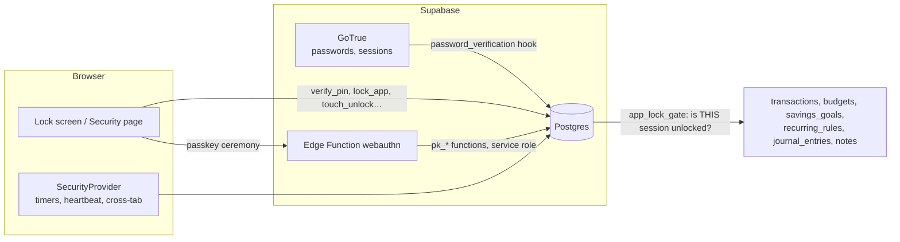
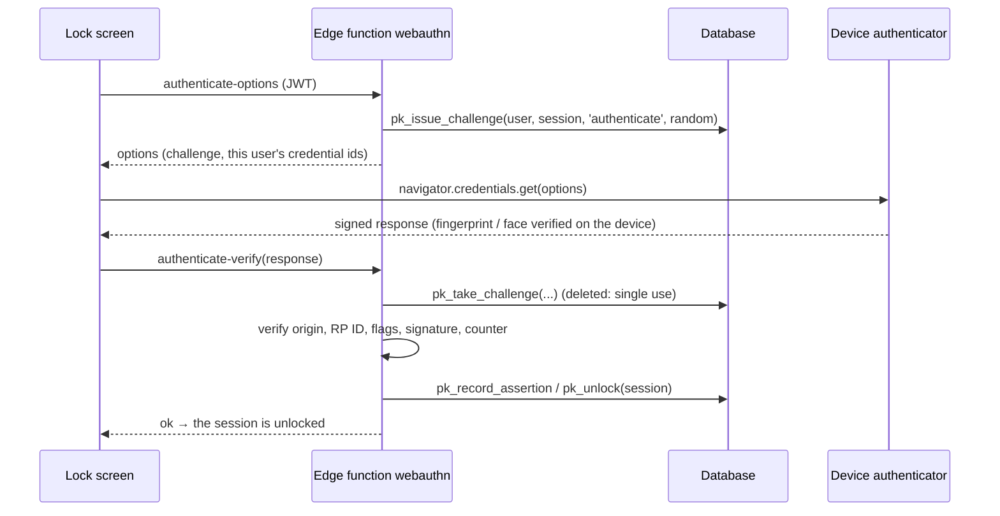
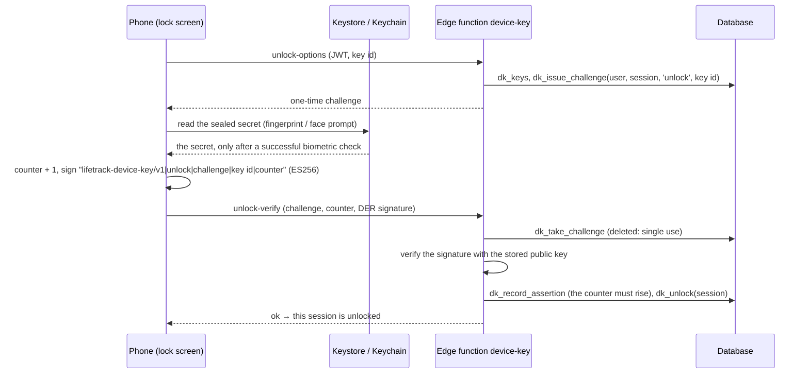

# Security & Privacy: password, app lock, fingerprint / face unlock, sessions

The web app has a **Security & Privacy** page (`/security`) and a lock screen, and the mobile app has the same lock (§9). This document says what they do, how the lock is enforced, what you must deploy,
and what they do **not** do. The wider security review is [SECURITY.md](SECURITY.md); the disclosure policy is [../SECURITY.md](../SECURITY.md).

| What | Where | Status |
| --- | --- | --- |
| Change password with the current one checked, strength rules and a live meter | `/security`, sign-up, reset | ✅ |
| Lockout after repeated wrong passwords | database hook (you switch it on, §3) | 🟡 needs a dashboard step |
| App lock: 4 or 6 digit PIN, auto-lock, lock now, lock when returning | `/security`, lock screen | ✅ |
| Server-enforced: Finance, Journal and Notes refuse a locked session | RLS policy `app_lock_gate` | ✅ (Supabase builds) |
| **Module locks**: lock only Finance, Health, Fitness, Nutrition, Jobs or Journal; locked cards on the dashboard, an unlock prompt, one unlock for all (§4a) | `/security` → *What to lock*, migration 0015 | ✅ web, 🟡 run `0015_module_locks.sql` |
| Fingerprint / face / device-PIN unlock through WebAuthn passkeys | `/security`, lock screen, `webauthn` Edge Function | 🟡 needs the function deployed (§5) |
| Registered devices: add, rename, remove | `/security` | ✅ |
| Active sessions: list, sign out one, others, or everywhere; trust a phone | `/security` | ✅ |
| App lock on the phone: lock screen, PIN keypad, auto-lock, lock again when returning, Security & Privacy screen | mobile app | ✅ built, tested without a device; not run on one yet (§9) |
| Fingerprint / face unlock on the phone: Android BiometricPrompt + Keystore, iOS LocalAuthentication + Keychain | mobile app, `device-key` Edge Function, `0014_device_keys.sql` | 🟡 needs the migration run and the function deployed (§7); not run on a device (§9) |

## 1. What was there before

Audited before any change (`packages/data/src/auth.js`, `apps/web/src/services/auth.js`, `hooks/useAuth.jsx`, `supabase/`):

- **Sign-in is Supabase Auth** (GoTrue): email + password, bcrypt storage, JWT access tokens with refresh tokens, PKCE, a password-reset email flow. There is **no custom server**.
  Authorisation is Row Level Security. All of that stays as it was; no user and no data was touched.
- **Gaps this work closes:** changing the password never asked for the current one (`updateUser({ password })` only); new passwords needed 8 to 72 characters and nothing
  else (`password123` was fine); the in-browser dev backend stored an **unsalted SHA-256**; no way to see or end a session; no app lock of any kind.
- **Left alone on purpose:** the sign-in, sign-up, forgot and reset flows, account deletion, display-name change, the session storage, and the mobile app (which got its own lock afterwards: §9).

## 2. How the lock is enforced

A lock drawn only in the browser is decoration: anyone with the session token can call the API without ever seeing the screen. So the **database records which session is
unlocked**, and the sensitive tables ask it on every query.

- `user_security` holds the lock settings and the **bcrypt** PIN hash. `app_unlocks` has one row per **unlocked session** (the `session_id` claim of the user's JWT).
- `verify_pin` (or a verified passkey signature, or typing the password just now) writes that row. `lock_app` (which leaves a marker behind), the auto-lock window running out, signing the device out, or turning the lock off end it.
- A **RESTRICTIVE** policy `app_lock_gate` on `transactions`, `budgets`, `savings_goals`, `recurring_rules`, `journal_entries` and `notes` is ANDed with each table's existing `owner_all`
  policy. It can only take access away, and only from a locked session. Reads return no rows; writes are refused. Everything else (tasks, habits, health…) is not gated on the server;
  the lock screen still hides it, but a copy of the token could read it. To protect another table, add its name to the array at the end of `0012_security.sql`.
- With **no app lock** the function answers "unlocked" for everyone, so nothing changes for a user who never turns it on.
- The unlock window is the auto-lock time (at least 60 s) plus 30 s of slack for the heartbeat. The page locks itself earlier; the window is the server's backstop for a tab that
  was closed or went offline. A **trusted** session (below) never expires.
- The session must still **exist** in `auth.sessions` to count as unlocked, so signing a device out (even through GoTrue's "sign out others / everywhere", or after a password change)
  closes the sensitive tables for it at once, although its access token stays valid until it expires (`jwt_expiry`, 1 hour by default).

The browser shows the lock screen from what the server says (`security_state().locked`). It never decides: the page keeps the app **unmounted** while locked, drops cached data (`resetStore()`),
clears toasts, and renders nothing until the first answer arrives. The phone follows the same rule: while its session is locked the lock screen replaces the whole navigator, so no screen is mounted (§9).

## 3. Account password

| Rule or behaviour | Detail |
| --- | --- |
| Storage | GoTrue's bcrypt. The app never sees or stores it. |
| New password strength | At least 8 characters, at most 72 **bytes** (bcrypt ignores the rest); not one of the most common passwords or a small variation (`Password1!`, `p@ssw0rd`, `Welcome2024!`); not built from the name or email; not mostly runs or repeats (`abcd1234`, `aaaaaaaa`). A live meter explains. One module, `packages/core/src/security.js`, used by every form. |
| Where it applies | Sign-up, reset, change. **Signing in is never checked**, so older accounts with weaker passwords keep working. |
| Change password | `/security`. Asks for the current password, checks it with GoTrue on a **throwaway client** (signing in on the live client would replace the session, and the unlock is bound to the session), updates it, then signs every **other** device out. |
| Lockout | Supabase has per-IP limits but no per-account lockout. `hook_password_verification_attempt` (0012) adds one: every 5th wrong password in a row blocks password sign-in for 1 min, doubling to 15 min; a right password during the lockout is refused too. **It does nothing until you enable it:** Dashboard → Authentication → Hooks → *Password verification attempt* → Postgres function → `public.hook_password_verification_attempt` (local: `[auth.hook.password_verification_attempt]` in `config.toml`). Hosted projects need a plan that includes auth hooks. |
| Re-authentication | The "type your current password" step is made by the app, and GoTrue checks that password; but GoTrue itself lets **any valid session** call `updateUser({ password })`, so a thief holding a token could skip the form. The server-side counterpart is the dashboard's **Secure password change** (email provider settings): GoTrue then refuses a password change from a session older than 24 hours unless it is re-authenticated. Turn it on; the form copes (it signs in afresh with the password it just checked and retries). |
| Sessions and logout | Sign out (this device), and from the Security page: one other device, all other devices, everywhere (§6). |

## 4. App lock (PIN)

- **PIN**: 4 or 6 digits, chosen twice. Easy ones are refused with the reason (`0000`, `1234`, `4321`, `2580`, `112233`…); the same rule runs in the browser and in the database
  (a test compares all 10,000 four-digit PINs between the two). Hashed with **bcrypt cost 12** in the database and never returned. The PIN travels over TLS to a database function and LifeTrack stores it nowhere else.
- **Wrong PINs** are *returned*, not raised, because raising would roll back the very counter that makes the lockout work. The check takes a row lock, so firing 100 guesses at once cannot get past the counter.

| Wrong PINs in a row | Result |
| --- | --- |
| 5 | PIN entry locked for 30 s (even the right PIN is refused meanwhile) |
| 10, 15, 20 … | Locked for 1, 2, 4 … minutes (never more than 1 h) **and the session is ended**, so guessing on needs the account password |
| right PIN, or a sign-in with the password, or a passkey | count reset |

- **Auto-lock**: when I leave the app, or after 1, 5, 15, 30 or 60 minutes. The clock counts from the last tap, key press or scroll; hiding the tab starts the same clock;
  coming back after longer than the setting locks again; **other tabs lock too**. While you are active the page sends a heartbeat so the server's window never lapses under you.
  "When I leave the app" locks the moment the tab is hidden, and a reload counts as leaving.
- **Lock now**: Security page, or the profile menu while the lock is on. Locking one device does not lock another (the lock is per session).
- **Opening it**: PIN on an animated keypad (the keyboard works too), or fingerprint / face (§5). A phone-like flow: the sensor is offered first, once, and a cancelled prompt leaves the PIN pad ready.
- **Right after typing your password** the new session opens without the PIN (`unlock_after_login`, only for a session under a minute old that was never unlocked or locked). The password is the stronger proof.
  "Lock now" followed by a reload still asks for the PIN: locking leaves a marker that blocks this shortcut.
- **Forgot the PIN**: "Forgot PIN?" on the lock screen takes the account password, which opens LifeTrack. Then *I forgot my PIN* on the Security page asks for the password again and sets a new PIN
  (`reset_app_lock`, only within 10 minutes of signing in), which also **locks every other device again**. Anyone with your password can do this: the PIN protects a stolen device or session, not the account.
- **Trusted devices**: before the mobile app had a lock screen, a phone with the lock on lost Finance, Journal and Notes, so an unlocked session could mark *another* session as
  **trusted** (never itself): it skips the PIN until you withdraw it, sign it out, reset the PIN or turn the lock off. The current mobile app does **not** need this: it asks for the PIN, or a fingerprint or
  face, and unlocks its own session (§9). The mark remains for any client that cannot show a lock screen (an older build of the app); anyone holding a trusted device can read those sections, and the Security
  screen on the phone lists trusted sessions with an *Ask for PIN* button to withdraw the mark.
- **Turning it off** needs the PIN. Changing it needs the current one.

## 4a. Module locks: lock only some modules

The app lock can lock **the whole app** (the default, §4) or **only the modules you choose**: Finance, Journal & notes, Health & sleep, Gym & fitness, Food & nutrition, Job switch.
Choose under Security & Privacy → App lock → *What to lock*. It reuses the same PIN, fingerprint / face unlock and auto-lock time; nothing new to set up.

| | Whole app | Only the modules I choose |
| --- | --- | --- |
| Lock screen | Yes, nothing shows until you unlock | **No.** LifeTrack opens as usual |
| Dashboard | n/a | A locked module's card is replaced by a **Locked · Tap to unlock** card; the "Today at a glance" tiles of that module show a lock |
| Module page (`/finance`, …) | n/a | The unlock pad is shown instead of the page (the page is not even loaded) |
| Unlocking | PIN, passkey, or typing the password again | PIN or passkey. **One unlock opens every locked module** until the auto-lock time runs out or you press *Lock now* |
| A fresh password sign-in | Opens the app without the PIN | Does **not** open the modules: the point is to be asked each time |
| Closed on the server | Finance, Journal & notes (as before) | Every table of each module you chose (list below) |

- **Enforced like the app lock.** Migration `0015_module_locks.sql` adds `lock_scope` and `locked_modules` to `user_security`, a function `module_session_open(module, gated_in_app)`, and a RESTRICTIVE policy on the tables of each module
  (`app_lock_gate` on the two legacy modules, `module_lock_gate` on the others). A session that has not entered the PIN reads nothing from a locked module and cannot write to it. Choosing what to lock (`set_lock_modules`) needs an
  **unlocked** session and the app lock on, so a locked device cannot edit its own list. Going back to "the whole app" keeps the list; turning the app lock off forgets it.
- **Tables per module** (`packages/core/src/moduleLocks.js` and the end of the migration; a test compares them): Finance `transactions, budgets, savings_goals, recurring_rules` · Journal & notes `notes, journal_entries` ·
  Health `health_logs, body_measurements` · Fitness `workouts, exercise_logs` · Nutrition `food_logs, nutrition_settings, water_logs` · Jobs `job_applications, application_history, interview_events`.
  Under the **whole-app** lock only the first two modules are closed on the server, exactly as before; the others are closed on the server only when you lock them as a module.
- **What the page does while a module is locked.** The dashboard computes every figure from data with the locked modules' tables emptied (so the Life Score, activity, upcoming and Today figures leave them out, and a line says so
  with an *Unlock* button), the sidebar shows a padlock, **Quick add** asks to unlock instead of opening a form the database would refuse, and **Data Export** waits until everything is unlocked (a backup or erase made
  meanwhile would silently skip the locked modules). On unlock, or lock, the page drops what it loaded and reloads.
- **Not covered.** Pages that add up several modules (Analytics, Reports, Planner, Calendar) simply see empty data for a locked module on a Supabase build; they are not replaced by a lock. Notifications that were already
  created (for example a budget warning) are not locked. The **mobile app** does not know module locks yet: with module locks on, the phone shows the locked modules as empty until it is marked *trusted*
  (Security & Privacy → Where you're signed in), which opens them for that device. The DEV backend has no server, so it only hides the modules on screen.
- **Deploying.** Run `0012_security.sql`, then `0015_module_locks.sql` (additive, safe to re-run, off by default for every account; the number 0014 is held by the phone-biometrics work). Until it runs, the choice is not
  offered and the lock behaves as in §4.

## 5. Fingerprint and face unlock (WebAuthn passkeys)

JavaScript in a browser **cannot read a fingerprint or a face, and LifeTrack does not claim to**. What the browser offers is WebAuthn: the device's own authenticator (Touch ID, Windows Hello,
Android biometrics, or the device screen-lock PIN) checks the person and signs a challenge with a private key that never leaves the device. LifeTrack receives only that signed answer.

- **Registering** needs an **unlocked** session with the lock on, otherwise a stolen token could enrol its own "fingerprint". Up to 10 devices; rename and remove on the Security page; removing the last one turns the feature off.
- **What the server checks** (`packages/core/src/webauthn.js`, WebCrypto only, no dependencies): the one-time challenge (2 minutes, tied to the user, the session and the purpose, deleted on use, so a recorded
  response cannot be replayed); the **origin** against an allow-list; the **RP ID hash**; user presence **and user verification** flags (a sensor that only confirms presence is refused); algorithm (ES256 or RS256);
  the public key; the **signature** over `authenticatorData ‖ SHA-256(clientDataJSON)`; and the **signature counter**, which must move forward (a cloned authenticator is detected). Attestation is "none": we learn
  that *a* user-verifying device signed, not which model.
- A bad signature counts toward the **same lockout as a wrong PIN** (and can end the session). An expired challenge does not: that is only slowness.
- Only the service role can call the `pk_*` functions; public keys, counters and challenges are never readable by a client, and only public keys are stored.
- Passkeys are bound to the site's **RP ID** (its domain). If you move the app to another domain, they stop working there (the PIN still does); register them again.
- "Synced" in the list means the platform backs the passkey up (iCloud Keychain, Google Password Manager); "This device only" means it cannot leave the device.
- **Where it works:** any current browser on a device that has a fingerprint, face or screen-lock sensor and a secure (https or `localhost`) page; the app asks the browser
  (`isUserVerifyingPlatformAuthenticatorAvailable`) and says why when it is unavailable. It is never required: the PIN always works.

## 6. Sessions

`/security` → *Where you're signed in* lists each session of the account (browser and system parsed from the user agent, IP, last active, signed in, locked / unlocked / trusted).
*Sign out* ends one (its refresh tokens go with it and its unlock record is deleted); *Sign out other devices* and *Sign out everywhere* use GoTrue's `scope: 'others' | 'global'`.
An access token already issued stays valid until it expires (`jwt_expiry`, 1 hour by default; lower it in the project's Auth settings for a tighter window), but with the lock on the sensitive tables
close at once (§2). A device that was signed out elsewhere is told "Your session has ended" on its next check (a focus, a heartbeat, or a PIN attempt) and returns to the sign-in screen, rather than sitting at a
lock that can never open. Listing sessions needs an unlocked session.

## 7. Deploying it

1. **Run `supabase/migrations/0012_security.sql`** (SQL Editor, `supabase db push`, or paste `setup-all.sql`). Additive and safe to re-run. It needs `pgcrypto` in the `extensions` schema (the Supabase default) and
   fails with a clear message if not. Until you do, the app simply opens as before and the Security page says what to run.
2. **Fingerprint / face unlock** (optional): `supabase functions deploy webauthn` (leave JWT verification **on**), then
   `supabase secrets set WEBAUTHN_RP_ID=app.example.com WEBAUTHN_ORIGINS=https://app.example.com`. `WEBAUTHN_RP_ID` is the domain only, no scheme or port;
   `WEBAUTHN_ORIGINS` is a comma-separated list of the exact origins of the web app (`http://localhost:5173` and `localhost` for development). Unset, the function answers "not configured" and the app hides the feature.
3. **Fingerprint / face unlock on phones** (optional): run `supabase/migrations/0014_device_keys.sql` (additive, safe to re-run; needs 0012 first), then `supabase functions deploy device-key` (leave JWT verification **on**).
   It needs **no secrets and no domain**: a phone's key is not tied to a website. Without it the phone's Security screen says it is not set up on the server and only the PIN is offered. The phone also needs a
   **new build** of the app: it adds two native modules (`expo-local-authentication`, `expo-crypto`) and an iOS `NSFaceIDUsageDescription`, and nothing in the app is delivered over the air ([NATIVE.md](NATIVE.md)).
4. **Password lockout hook** (recommended): see §3.
5. **Hardening** (recommended): *Secure password change* (§3); a shorter `jwt_expiry`; keep "Confirm email" on.
6. The Content-Security-Policy needs no change (`connect-src` already allows `https://*.supabase.co`, which covers both functions).
7. Smoke test: sign in, turn the lock on, lock, enter the PIN, add a device, lock, unlock with it, sign out another session. On the phone: open More → Security & Privacy, turn on fingerprint unlock, lock now, unlock with
   the sensor; add a wrong PIN and watch the count; sign in on the web and check the phone is listed.

## 8. The in-browser DEV backend

With no Supabase credentials (`pnpm dev`, the unit tests, the hermetic e2e build) the same API runs against `localStorage` (`services/localSecurity.js`), with the **same rules and the same shared code**
(PIN rules, lockout schedule, WebAuthn verification). There is **no server**, so it is a real screen lock but not protection for the stored data, and the Security page says so. Passwords there are now
**salted PBKDF2** (they were an unsalted SHA-256); accounts created before that sign in and are upgraded on the spot. It is compiled out of production bundles (`verify:bundles`).

## 9. Mobile: the lock on the phone

The mobile app has the same app lock as the web: a full-screen lock with a PIN keypad, fingerprint / face unlock, auto-lock, and a **Security & Privacy** screen (More → Security & Privacy, or Settings → Account).
With the web lock on, a phone no longer needs to be marked *trusted* (§4): it asks for the PIN, or a fingerprint or face, and unlocks **its own session**. The server treats it exactly as it treats a browser (§2):
while its session is locked, Finance, Journal and Notes return nothing to it, whatever the app shows.

### 9.1 What the phone does

| Behaviour | How |
| --- | --- |
| **Nothing is mounted behind the lock** | `Gate` in `app/_layout.tsx` renders `LockScreen` **instead of the navigator** while the server says the session is locked, so no screen, realtime channel or reminder runner exists; cached rows are dropped (`queryClient.clear()`). Before the first answer arrives nothing renders either (the native splash stays up). If the server cannot be asked, "Can't check your security settings" with *Try again* and *Sign out*: it fails **closed**. Unlocking mounts the app afresh, back at the home tab (navigation state is not kept: that is the price of mounting nothing). |
| **The server decides** | `security_state()` is the only source of "locked". `verify_pin` (or the `device-key` function) writes the unlock; the phone only displays it. A wrong PIN is counted by the server's lockout, never by the phone. |
| **Auto-lock** | *When I leave the app*: locks as soon as the app goes to the background (iOS "inactive", which is the notification shade or a system prompt, does not count). 1 to 60 minutes: any touch is activity, an open keyboard counts as typing (a phone cannot see key presses), and coming back after longer than the time away locks again (an iPhone suspends timers in the background, so the wall clock decides). A system prompt, such as the fingerprint sheet, is held so the app does not mistake it for the person leaving. |
| **Heartbeat** | While the person is active the app calls `touch_unlock` every 10 to 30 seconds, so the server's window (auto-lock time + 30 s) never lapses under them. Idle, it sends nothing and the window runs out by itself. |
| **Sign-in, forgot PIN, sessions** | As on the web: a session under a minute old that was created by typing the password opens without the PIN (`unlock_after_login`); *I forgot my PIN* takes the account password, then lets that fresh session choose a new PIN (`reset_app_lock`), which locks every other device again; the session list can end other devices and withdraw a *trusted* mark; *Lock now* is on the Security screen. |
| **A database without `0012`** | `NOT_INSTALLED` is recognised: the app opens as before and the Security screen says what to run. |
| **A session ended elsewhere** | `28000` is recognised: the phone signs out, instead of sitting at a lock that can never open. |

The rules (when to lock, what to ask the server, what to do when it cannot be asked) are `features/security/lockController.ts`, free of React and of the real clock, so they are tested with a fake clock and a fake server (§11).
The React parts are `SecurityProvider.tsx` (AppState, touches, the signed-in user), `LockScreen.tsx`, `PinKeypad.tsx`, `PinWizard.tsx` and `SecuritySections.tsx`.

### 9.2 Fingerprint and face unlock: device keys

A native app should use the platform's own primitives rather than WebAuthn. The unlock is a **signature from a key that the operating system releases only after a biometric check**, verified by the server (`device-key` Edge
Function, tables `device_keys` and `device_key_challenges` of `0014_device_keys.sql`). A boolean in the app ("the biometric check passed") unlocks nothing: it does not exist anywhere in the protocol. The server reads a
signature and nothing else.

- **Adding a phone** (Security → Fingerprint & face unlock → Turn on) needs an **unlocked** session with the app lock on, otherwise a stolen token could enrol its own "fingerprint". The phone makes a P-256 key pair,
  seals the private half behind the biometrics, and proves it holds it with a signature over a fresh challenge (`lifetrack-device-key/v1|enroll|challenge|x|y`). The server stores the public key and its RFC 7638 thumbprint
  (one key, one account, once), up to 10 phones; rename and remove are on the same screen. **Turning the app lock off removes every phone** (a trigger on `user_security`), as it already switches web biometrics off.
- **What the server checks** (`packages/core/src/devicekey.js`, WebCrypto only; the Deno copy is generated by `scripts/sync-function-core.mjs`): the one-time challenge (2 minutes; bound to the user, the session, the purpose and
  the key; deleted when used, so a recorded signature cannot be replayed or carried to another session); the public key (P-256, no private part, canonical encoding); the **ECDSA signature** over exactly the text above;
  and a **counter** that must move forward, so a copied key is noticed. A bad signature counts toward the **same lockout as a wrong PIN** (`_register_failure`: the fifth locks PIN entry, the tenth ends the session).
  An expired challenge, a key removed meanwhile, or a request that is merely malformed does not count. The function is for native apps: a request carrying an `Origin` header (a browser) is refused and no CORS header is ever sent.
- **Where the key lives** (`features/security/deviceKey.ts`): `expo-secure-store` seals it. *Android*: an AES-256-GCM key in the **Android Keystore** created with `setUserAuthenticationRequired(true)` (no validity window:
  authentication for every use, by BiometricPrompt with a CryptoObject, class 3 "strong" biometrics only; a new fingerprint invalidates it). *iOS*: a **Keychain** item with the `biometryCurrentSet` access control and a
  this-device-only accessibility class: Face ID / Touch ID (LocalAuthentication) must succeed to read it, and adding a finger or face destroys it. `expo-local-authentication` tells the app what the phone can do (sensor,
  enrolled biometrics, strength) and what to call it (Face ID, Touch ID, Fingerprint, Face unlock). When the phone's biometrics change the key store returns nothing: the phone stops offering it, says why, and offers to set it up again.
- **What this does not give.** The secret is not in secure hardware for its whole life: it is in the app's memory for the instant it signs, and the signature is computed in JavaScript (`@noble/curves`, because Hermes has no
  WebCrypto and Expo has no API for a hardware-resident EC key). Code running inside the unlocked app at that moment could read it. It still cannot sign without a biometric check to release it, and the server needs a live
  session for the same user as well. The wire format is what a hardware key produces (ASN.1 DER ES256), so a native module could replace `ecdsa.ts` and `deviceKey.ts` later without any server change.
- **The counter** lives in the phone's own secure storage (not behind the biometrics) next to the key id, and goes up *before* every signature, so a number is never used twice. If the phone loses it (a restored backup) or
  the server has already seen a higher one, the unlock is refused, counted like a wrong PIN, and the phone offers to set it up again.
- **The PIN is always the fallback.** A dismissed prompt is silent and counts for nothing; a locked-out sensor says so. Nothing in the biometric path can turn the PIN off.

### 9.3 What could not be tested without a physical device

Everything above is covered by tests that run here (§11), and both Hermes bundles build (`expo export` for Android and iOS). These parts have **not** been run on a real phone, and should be walked through once on an Android
phone and an iPhone before release:

- The system prompts themselves (BiometricPrompt, Face ID, Touch ID) and what `expo-secure-store` does with `requireAuthentication` on each OS: that a new fingerprint really destroys the key, and the wording of a
  cancel or a sensor lockout (the app recognises them by their message text, "cancel" and "lockout").
- Hermes running `@noble/curves` (BigInt arithmetic: the first signature builds precomputed tables, so the first unlock after a cold start may take noticeably longer than later ones), and `expo-crypto` supplying the randomness.
- `AppState` on real devices: background and inactive transitions on both OSes (in particular whether a biometric prompt flips the state; the app holds auto-lock during its own prompts), touches reaching the activity
  capture through real gesture handlers, and the keyboard heuristic.
- Expo Router when the lock screen replaces the navigator and the app mounts again (the home tab after unlock), and a deep link opened while locked (kept, followed after the unlock).
- The two Edge Functions under Deno against a live Supabase project (GoTrue, a JWT's `session_id`, the service role), and migration 0014 on real Postgres (PGlite and the in-memory test database have run it; the Linux-only
  real-Postgres suite has not).
- The native build: Gradle and Xcode with the two new modules, the iOS `NSFaceIDUsageDescription` (the `expo-local-authentication` config plugin adds it), and the Android `USE_BIOMETRIC` permission.
- Leaks outside the app: the OS's app-switcher snapshot still shows the last screen of an unlocked app (there is no privacy cover yet). A notification tapped while locked opens the lock screen; its link is followed once the
  app opens, and only once (the app remembers which taps it has acted on, because it is mounted again after every unlock).

## 10. Where the code is

| Piece | Files |
| --- | --- |
| Database | `supabase/migrations/0012_security.sql` (lock, passkeys, sessions), `0014_device_keys.sql` (the phone's biometric keys), `0015_module_locks.sql` (module locks) |
| Edge Functions | `supabase/functions/webauthn/` (web passkeys), `supabase/functions/device-key/` (phones): `index.ts` wiring, `logic.js` decisions; `_shared/webauthn.js` and `_shared/devicekey.js` (generated copies) |
| Shared rules | `packages/core/src/security.js` (passwords, PINs, lockout, auto-lock), `packages/core/src/webauthn.js` (passkey verification), `packages/core/src/devicekey.js` (what a phone signs, and its verification) |
| Client API | `packages/data/src/security.js` (`deviceKeys` for the phone), `packages/data/src/auth.js` (`changePassword`) |
| Web | `apps/web/src/features/security/` (provider, lock screen, keypad, fingerprint animation, page and cards), `services/security.js`, `services/localSecurity.js`, `lib/webauthn.js` |
| Mobile | `apps/mobile/src/features/security/` (`lockController.ts` rules, `lockPolicy.ts`, `SecurityProvider.tsx`, `LockScreen.tsx`, `PinKeypad.tsx`, `PinWizard.tsx`, `SecuritySections.tsx`, `deviceKey.ts`, `ecdsa.ts`), `src/lib/security.ts`, `app/_layout.tsx` (`Gate`), `app/(app)/module/security.tsx` |

## 11. Tests

| Suite | Covers |
| --- | --- |
| `supabase/tests/pglite/security.test.ts` | The gate on every protected table, PIN set / verify / change / disable / reset, lockout and the shared schedule, unlock window and heartbeat, trusted devices, sessions, passkey functions (single-use challenges, counters, privileges), the password hook, the migration re-run. Mutation-checked. |
| `packages/core/tests/security.test.js`, `webauthn.test.js`, `webauthn-function.test.js` | Rules; the verifier against a software authenticator (ES256 and RS256, every rejection path); the Edge Function's decisions with a fake database. |
| `packages/data/tests/security.test.js` | The client API, error mapping, `changePassword`. |
| `supabase/tests/pglite/moduleLocks.test.ts`, `packages/core/tests/moduleLocks.test.js`, `apps/web/tests/moduleLocks.test.jsx` | Module locks: every table of every module closed to a locked session and open after the PIN, the list compared with the database, who may change it, scope switching, the dashboard overlay, locked pages, Quick add, Export, the settings. |
| `apps/web/tests/localSecurity.test.js`, `devAuthSecurity.test.js`, `securityUi.test.jsx` | The dev backend, the gate, lock screen, Security page and cards in jsdom. |
| `supabase/tests/pglite/deviceKeys.test.ts` | Migration 0014: the new tables are closed to every client role, list / rename / remove need an unlocked session, challenges (single use, bound to session, purpose and key, expiry, the cap), the strictly forward counter, enrolling (needs the lock, cap, one thumbprint), unlocking a session (opens Finance, Journal and Notes for that session only, clears the PIN lockout), the shared lockout schedule, the trigger that removes phones when the lock goes off, a privilege matrix read from the migration itself, the re-run. Mutation-checked. |
| `packages/core/tests/device-key.test.js`, `device-key-function.test.js` | The verifier against a software phone built on OpenSSL (every rejection path, the exact signed text, thumbprints, private keys refused); the `device-key` function's decisions with a fake database (locked sessions cannot enrol, replay, wrong session or key, forged signatures counted, cloned counter, the 5th and 10th failure, nothing but a signature is read, browsers refused). |
| `packages/data/tests/deviceKeys.test.js` | The client API for phones, error mapping, the right function names, which migration is missing. |
| `apps/mobile/tests/ecdsa.test.ts`, `deviceKey.test.ts` | The phone's signer against OpenSSL and WebCrypto; the whole device-key service driven **against the real Edge Function logic** (enrol, unlock, cancel, sensor lockout, a destroyed key, a removed key, a cloned counter, lockout and sign-out passed on, a lost connection, reconcile, turn off), with a stand-in for `expo-secure-store` that releases a sealed item only after its prompt succeeds. |
| `apps/mobile/tests/lockPolicy.test.ts`, `lockController.test.ts` | When the phone locks (idle, background, return, held prompts, keyboard), the heartbeat, the first look (the password shortcut, no migration, ended session, failing closed), a different person, lock now. Fake clock, fake server. |
| `apps/mobile/tests-rn/gate.test.tsx`, `lockScreen.test.tsx`, `securityScreen.test.tsx` | The root `Gate` (nothing of the app is mounted while locked, loading, or failing closed; links wait for the unlock), the lock screen and PIN pad (right and wrong PIN, lockout, sign-out, forgot PIN, the sensor button and its auto-offer), the Security screen (turning the lock on with a PIN chosen twice, easy PINs, change, turn off, auto-lock, phones, sessions). |
| `apps/web/e2e/security.spec.js`, `security-responsive.spec.js` | Real Chromium: lock, wrong and right PIN, lockout, idle and hidden-tab auto-lock (fake clock), a **real WebAuthn virtual authenticator** end to end, passwords, legacy-account upgrade, accessibility scans, phone viewport. |

The phone's rules were **mutation-checked** like the database ones: each rule was switched off in turn (21 in the migration, 32 across the function's decisions, the verifier, the phone's service and the controller: a missing session check, a challenge that is not consumed, a counter that may repeat, a secret read without its protection, a screen that is not locked first…) and a test failed every time; the mutants that first survived got a test.

Not testable here: a real Supabase stack (GoTrue sessions, PostgREST claims, the deployed function, the password hook) and real fingerprint sensors. Treat those as unproven until the checklist in §7 has been run once.

## 12. What this does not do

- It is **not multi-factor sign-in**: passkeys unlock the app for a session that is already signed in. Signing in is still email and password.
- **The app lock does not protect the account.** GoTrue lets any valid session change the password or email, and that is outside the database's reach (GoTrue does not tell Postgres who is calling). Someone who
  steals a live session can therefore take the account over even though they cannot read Finance. Mitigate with *Secure password change*, short session lifetimes (Auth settings), and by treating a stolen device as
  a compromised account: change the password from another device, which signs this one out.
- A 4 or 6 digit PIN cannot survive an offline attack on a leaked database whatever the hash. Its protection is the online lockout; the account password is the real secret.
- Under the whole-app lock, tables other than the six above are hidden by the lock screen but not closed on the server (module locks, §4a, close the others when you choose them).
- Notes, journal and finance data are not encrypted at rest by the app (Supabase encrypts storage); the lock controls who is served them.
- **No session cookies.** Sign-in sessions are Supabase's tokens in the browser's `localStorage` (mobile: the OS keychain). HttpOnly cookies need a server of our own to set them; there is none, and adding one is a
  different architecture. The strict Content-Security-Policy and the absence of HTML-injection sinks are the mitigation ([SECURITY.md §9](SECURITY.md) #4).
- **There is no separate documents feature.** "Sensitive documents" is covered by the private **journal** and **notes**, which are gated on the server together with the finance tables.
- No sign-in alert emails, no security activity log, and no extra PIN step for export or account deletion.
- **On the phone:** the biometric key is released into the app's memory to sign (§9.2); the OS app-switcher snapshot is not covered by a privacy screen; after an unlock the app starts at the home tab, and anything typed
  but not saved when the phone locked is gone (nothing is mounted behind the lock).
