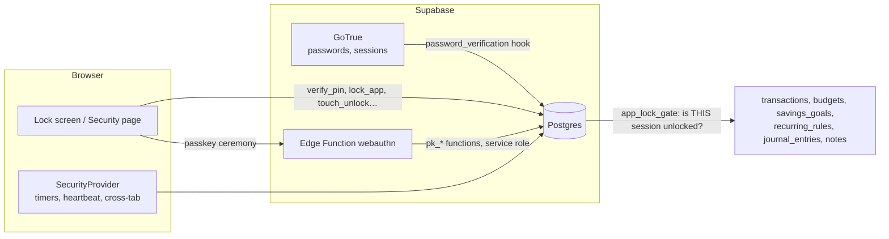
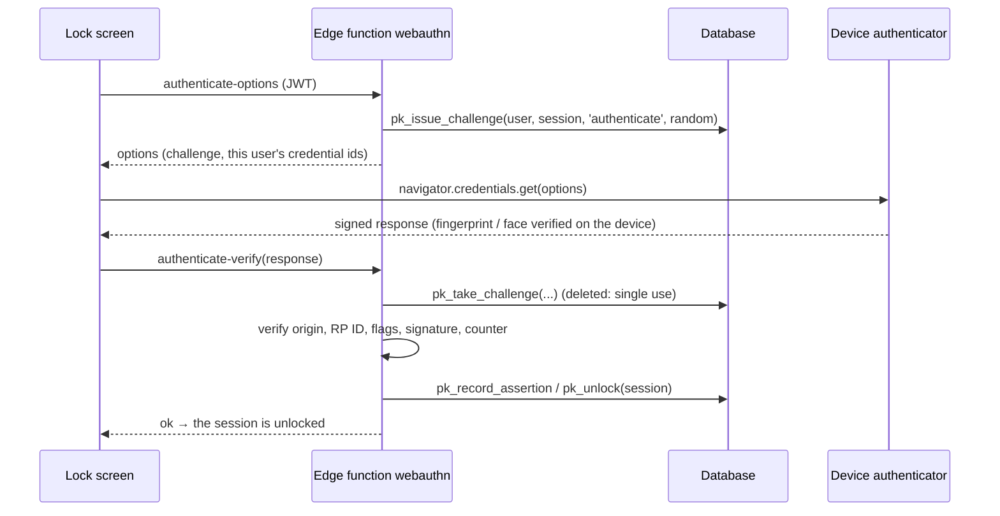

# Security & Privacy: password, app lock, fingerprint / face unlock, sessions

The web app has a **Security & Privacy** page (`/security`) and a lock screen. This document says what they do, how the lock is enforced, what you must deploy,
and what they do **not** do. The wider security review is [SECURITY.md](SECURITY.md); the disclosure policy is [../SECURITY.md](../SECURITY.md).

| What | Where | Status |
| --- | --- | --- |
| Change password with the current one checked, strength rules and a live meter | `/security`, sign-up, reset | ✅ |
| Lockout after repeated wrong passwords | database hook (you switch it on, §3) | 🟡 needs a dashboard step |
| App lock: 4 or 6 digit PIN, auto-lock, lock now, lock when returning | `/security`, lock screen | ✅ |
| Server-enforced: Finance, Journal and Notes refuse a locked session | RLS policy `app_lock_gate` | ✅ (Supabase builds) |
| Fingerprint / face / device-PIN unlock through WebAuthn passkeys | `/security`, lock screen, `webauthn` Edge Function | 🟡 needs the function deployed (§5) |
| Registered devices: add, rename, remove | `/security` | ✅ |
| Active sessions: list, sign out one, others, or everywhere; trust a phone | `/security` | ✅ |
| Android BiometricPrompt / Keystore, iOS LocalAuthentication / Keychain | mobile apps | 📋 planned, §9 |

## 1. What was there before

Audited before any change (`packages/data/src/auth.js`, `apps/web/src/services/auth.js`, `hooks/useAuth.jsx`, `supabase/`):

- **Sign-in is Supabase Auth** (GoTrue): email + password, bcrypt storage, JWT access tokens with refresh tokens, PKCE, a password-reset email flow. There is **no custom server**.
  Authorisation is Row Level Security. All of that stays as it was; no user and no data was touched.
- **Gaps this work closes:** changing the password never asked for the current one (`updateUser({ password })` only); new passwords needed 8 to 72 characters and nothing
  else (`password123` was fine); the in-browser dev backend stored an **unsalted SHA-256**; no way to see or end a session; no app lock of any kind.
- **Left alone on purpose:** the sign-in, sign-up, forgot and reset flows, account deletion, display-name change, the session storage, and the mobile app.

## 2. How the lock is enforced

A lock drawn only in the browser is decoration: anyone with the session token can call the API without ever seeing the screen. So the **database records which session is
unlocked**, and the sensitive tables ask it on every query.

- `user_security` holds the lock settings and the **bcrypt** PIN hash. `app_unlocks` has one row per **unlocked session** (the `session_id` claim of the user's JWT).
- `verify_pin` (or a verified passkey signature, or typing the password just now) writes that row. `lock_app` (which leaves a marker behind), the auto-lock window running out, signing the device out, or turning the lock off end it.
- A **RESTRICTIVE** policy `app_lock_gate` on `transactions`, `budgets`, `savings_goals`, `recurring_rules`, `journal_entries` and `notes` is ANDed with each table's existing `owner_all`
  policy. It can only take access away, and only from a locked session. Reads return no rows; writes are refused. Everything else (tasks, habits, health…) is not gated on the server;
  the lock screen still hides it, but a copy of the token could read it. To protect another table, add its name to the array at the end of `0012_security.sql`.
- With **no app lock** the function answers "unlocked" for everyone, so nothing changes for a user who never turns it on.
- The unlock window is the auto-lock time (at least 60 s) plus 30 s of slack for the heartbeat. The page locks itself earlier; the window is the server's backstop for a tab that
  was closed or went offline. A **trusted** session (below) never expires.
- The session must still **exist** in `auth.sessions` to count as unlocked, so signing a device out (even through GoTrue's "sign out others / everywhere", or after a password change)
  closes the sensitive tables for it at once, although its access token stays valid until it expires (`jwt_expiry`, 1 hour by default).

The browser shows the lock screen from what the server says (`security_state().locked`). It never decides: the page keeps the app **unmounted** while locked, drops cached data (`resetStore()`),
clears toasts, and renders nothing until the first answer arrives.

## 3. Account password

| Rule or behaviour | Detail |
| --- | --- |
| Storage | GoTrue's bcrypt. The app never sees or stores it. |
| New password strength | At least 8 characters, at most 72 **bytes** (bcrypt ignores the rest); not one of the most common passwords or a small variation (`Password1!`, `p@ssw0rd`, `Welcome2024!`); not built from the name or email; not mostly runs or repeats (`abcd1234`, `aaaaaaaa`). A live meter explains. One module, `packages/core/src/security.js`, used by every form. |
| Where it applies | Sign-up, reset, change. **Signing in is never checked**, so older accounts with weaker passwords keep working. |
| Change password | `/security`. Asks for the current password, checks it with GoTrue on a **throwaway client** (signing in on the live client would replace the session, and the unlock is bound to the session), updates it, then signs every **other** device out. |
| Lockout | Supabase has per-IP limits but no per-account lockout. `hook_password_verification_attempt` (0012) adds one: every 5th wrong password in a row blocks password sign-in for 1 min, doubling to 15 min; a right password during the lockout is refused too. **It does nothing until you enable it:** Dashboard → Authentication → Hooks → *Password verification attempt* → Postgres function → `public.hook_password_verification_attempt` (local: `[auth.hook.password_verification_attempt]` in `config.toml`). Hosted projects need a plan that includes auth hooks. |
| Re-authentication | The "type your current password" step is made by the app, and GoTrue checks that password; but GoTrue itself lets **any valid session** call `updateUser({ password })`, so a thief holding a token could skip the form. The server-side counterpart is the dashboard's **Secure password change** (email provider settings): GoTrue then refuses a password change from a session older than 24 hours unless it is re-authenticated. Turn it on; the form copes (it signs in afresh with the password it just checked and retries). |
| Sessions and logout | Sign out (this device), and from the Security page: one other device, all other devices, everywhere (§6). |

## 4. App lock (PIN)

- **PIN**: 4 or 6 digits, chosen twice. Easy ones are refused with the reason (`0000`, `1234`, `4321`, `2580`, `112233`…); the same rule runs in the browser and in the database
  (a test compares all 10,000 four-digit PINs between the two). Hashed with **bcrypt cost 12** in the database and never returned. The PIN travels over TLS to a database function and LifeTrack stores it nowhere else.
- **Wrong PINs** are *returned*, not raised, because raising would roll back the very counter that makes the lockout work. The check takes a row lock, so firing 100 guesses at once cannot get past the counter.

| Wrong PINs in a row | Result |
| --- | --- |
| 5 | PIN entry locked for 30 s (even the right PIN is refused meanwhile) |
| 10, 15, 20 … | Locked for 1, 2, 4 … minutes (never more than 1 h) **and the session is ended**, so guessing on needs the account password |
| right PIN, or a sign-in with the password, or a passkey | count reset |

- **Auto-lock**: when I leave the app, or after 1, 5, 15, 30 or 60 minutes. The clock counts from the last tap, key press or scroll; hiding the tab starts the same clock;
  coming back after longer than the setting locks again; **other tabs lock too**. While you are active the page sends a heartbeat so the server's window never lapses under you.
  "When I leave the app" locks the moment the tab is hidden, and a reload counts as leaving.
- **Lock now**: Security page, or the profile menu while the lock is on. Locking one device does not lock another (the lock is per session).
- **Opening it**: PIN on an animated keypad (the keyboard works too), or fingerprint / face (§5). A phone-like flow: the sensor is offered first, once, and a cancelled prompt leaves the PIN pad ready.
- **Right after typing your password** the new session opens without the PIN (`unlock_after_login`, only for a session under a minute old that was never unlocked or locked). The password is the stronger proof.
  "Lock now" followed by a reload still asks for the PIN: locking leaves a marker that blocks this shortcut.
- **Forgot the PIN**: "Forgot PIN?" on the lock screen takes the account password, which opens LifeTrack. Then *I forgot my PIN* on the Security page asks for the password again and sets a new PIN
  (`reset_app_lock`, only within 10 minutes of signing in), which also **locks every other device again**. Anyone with your password can do this: the PIN protects a stolen device or session, not the account.
- **Trusted devices**: the mobile app has no lock screen yet, so with the lock on its session would lose Finance, Journal and Notes. An unlocked session can mark *another* session as
  **trusted** (never itself): it skips the PIN until you withdraw it, sign it out, reset the PIN or turn the lock off. Use it for your phone; anyone holding a trusted device can read those sections.
- **Turning it off** needs the PIN. Changing it needs the current one.

## 5. Fingerprint and face unlock (WebAuthn passkeys)

JavaScript in a browser **cannot read a fingerprint or a face, and LifeTrack does not claim to**. What the browser offers is WebAuthn: the device's own authenticator (Touch ID, Windows Hello,
Android biometrics, or the device screen-lock PIN) checks the person and signs a challenge with a private key that never leaves the device. LifeTrack receives only that signed answer.

- **Registering** needs an **unlocked** session with the lock on, otherwise a stolen token could enrol its own "fingerprint". Up to 10 devices; rename and remove on the Security page; removing the last one turns the feature off.
- **What the server checks** (`packages/core/src/webauthn.js`, WebCrypto only, no dependencies): the one-time challenge (2 minutes, tied to the user, the session and the purpose, deleted on use, so a recorded
  response cannot be replayed); the **origin** against an allow-list; the **RP ID hash**; user presence **and user verification** flags (a sensor that only confirms presence is refused); algorithm (ES256 or RS256);
  the public key; the **signature** over `authenticatorData ‖ SHA-256(clientDataJSON)`; and the **signature counter**, which must move forward (a cloned authenticator is detected). Attestation is "none": we learn
  that *a* user-verifying device signed, not which model.
- A bad signature counts toward the **same lockout as a wrong PIN** (and can end the session). An expired challenge does not: that is only slowness.
- Only the service role can call the `pk_*` functions; public keys, counters and challenges are never readable by a client, and only public keys are stored.
- Passkeys are bound to the site's **RP ID** (its domain). If you move the app to another domain, they stop working there (the PIN still does); register them again.
- "Synced" in the list means the platform backs the passkey up (iCloud Keychain, Google Password Manager); "This device only" means it cannot leave the device.
- **Where it works:** any current browser on a device that has a fingerprint, face or screen-lock sensor and a secure (https or `localhost`) page; the app asks the browser
  (`isUserVerifyingPlatformAuthenticatorAvailable`) and says why when it is unavailable. It is never required: the PIN always works.

## 6. Sessions

`/security` → *Where you're signed in* lists each session of the account (browser and system parsed from the user agent, IP, last active, signed in, locked / unlocked / trusted).
*Sign out* ends one (its refresh tokens go with it and its unlock record is deleted); *Sign out other devices* and *Sign out everywhere* use GoTrue's `scope: 'others' | 'global'`.
An access token already issued stays valid until it expires (`jwt_expiry`, 1 hour by default; lower it in the project's Auth settings for a tighter window), but with the lock on the sensitive tables
close at once (§2). A device that was signed out elsewhere is told "Your session has ended" on its next check (a focus, a heartbeat, or a PIN attempt) and returns to the sign-in screen, rather than sitting at a
lock that can never open. Listing sessions needs an unlocked session.

## 7. Deploying it

1. **Run `supabase/migrations/0012_security.sql`** (SQL Editor, `supabase db push`, or paste `setup-all.sql`). Additive and safe to re-run. It needs `pgcrypto` in the `extensions` schema (the Supabase default) and
   fails with a clear message if not. Until you do, the app simply opens as before and the Security page says what to run.
2. **Fingerprint / face unlock** (optional): `supabase functions deploy webauthn` (leave JWT verification **on**), then
   `supabase secrets set WEBAUTHN_RP_ID=app.example.com WEBAUTHN_ORIGINS=https://app.example.com`. `WEBAUTHN_RP_ID` is the domain only, no scheme or port;
   `WEBAUTHN_ORIGINS` is a comma-separated list of the exact origins of the web app (`http://localhost:5173` and `localhost` for development). Unset, the function answers "not configured" and the app hides the feature.
3. **Password lockout hook** (recommended): see §3.
4. **Hardening** (recommended): *Secure password change* (§3); a shorter `jwt_expiry`; keep "Confirm email" on.
5. The Content-Security-Policy needs no change (`connect-src` already allows `https://*.supabase.co`, which covers the function).
6. Smoke test: sign in, turn the lock on, lock, enter the PIN, add a device, lock, unlock with it, sign out another session.

## 8. The in-browser DEV backend

With no Supabase credentials (`pnpm dev`, the unit tests, the hermetic e2e build) the same API runs against `localStorage` (`services/localSecurity.js`), with the **same rules and the same shared code**
(PIN rules, lockout schedule, WebAuthn verification). There is **no server**, so it is a real screen lock but not protection for the stored data, and the Security page says so. Passwords there are now
**salted PBKDF2** (they were an unsalted SHA-256); accounts created before that sign in and are upgraded on the spot. It is compiled out of production bundles (`verify:bundles`).

## 9. Mobile: today and the native plan

**Today** the mobile app is unchanged: it has no lock screen. With the web lock on, its session counts as locked and Finance, Journal and Notes stay closed there until you mark the phone **trusted**
(§4). Everything else keeps working.

**Planned (not built):** `packages/data/src/security.js` is plain supabase-js and already works from React Native: PIN unlock, lock, heartbeat and sessions need only screens. For biometrics, native apps
should use the platform primitives rather than WebAuthn:

- **Android**: `BiometricPrompt` (Expo: `expo-local-authentication`) unlocking an **Android Keystore** EC key created with `setUserAuthenticationRequired(true)` and
  `setInvalidatedByBiometricEnrollment(true)`; PIN as the fallback (`verify_pin`).
- **iOS**: `LocalAuthentication` for Face ID / Touch ID guarding a **Secure Enclave / Keychain** key (`.biometryCurrentSet`); PIN as the fallback.
- **Server contract**: enrol the device's public key; to unlock, the server issues a one-time challenge, the device signs it with the biometric-gated key, and the server verifies the ECDSA signature and unlocks the
  session, with the same single-use challenge, counter and lockout rules as passkeys. The verification helpers in `webauthn.js` (DER to raw ECDSA, JWK import) are reusable. A boolean in the app ("biometric passed")
  would *not* be acceptable: it is exactly the frontend state the server must not trust.

## 10. Where the code is

| Piece | Files |
| --- | --- |
| Database | `supabase/migrations/0012_security.sql` |
| Edge Function | `supabase/functions/webauthn/` (`index.ts` wiring, `logic.js` decisions), `_shared/webauthn.js` (generated copy) |
| Shared rules | `packages/core/src/security.js` (passwords, PINs, lockout, auto-lock), `packages/core/src/webauthn.js` (verification) |
| Client API | `packages/data/src/security.js`, `packages/data/src/auth.js` (`changePassword`) |
| Web | `apps/web/src/features/security/` (provider, lock screen, keypad, fingerprint animation, page and cards), `services/security.js`, `services/localSecurity.js`, `lib/webauthn.js` |

## 11. Tests

| Suite | Covers |
| --- | --- |
| `supabase/tests/pglite/security.test.ts` | The gate on every protected table, PIN set / verify / change / disable / reset, lockout and the shared schedule, unlock window and heartbeat, trusted devices, sessions, passkey functions (single-use challenges, counters, privileges), the password hook, the migration re-run. Mutation-checked. |
| `packages/core/tests/security.test.js`, `webauthn.test.js`, `webauthn-function.test.js` | Rules; the verifier against a software authenticator (ES256 and RS256, every rejection path); the Edge Function's decisions with a fake database. |
| `packages/data/tests/security.test.js` | The client API, error mapping, `changePassword`. |
| `apps/web/tests/localSecurity.test.js`, `devAuthSecurity.test.js`, `securityUi.test.jsx` | The dev backend, the gate, lock screen, Security page and cards in jsdom. |
| `apps/web/e2e/security.spec.js`, `security-responsive.spec.js` | Real Chromium: lock, wrong and right PIN, lockout, idle and hidden-tab auto-lock (fake clock), a **real WebAuthn virtual authenticator** end to end, passwords, legacy-account upgrade, accessibility scans, phone viewport. |

Not testable here: a real Supabase stack (GoTrue sessions, PostgREST claims, the deployed function, the password hook) and real fingerprint sensors. Treat those as unproven until the checklist in §7 has been run once.

## 12. What this does not do

- It is **not multi-factor sign-in**: passkeys unlock the app for a session that is already signed in. Signing in is still email and password.
- **The app lock does not protect the account.** GoTrue lets any valid session change the password or email, and that is outside the database's reach (GoTrue does not tell Postgres who is calling). Someone who
  steals a live session can therefore take the account over even though they cannot read Finance. Mitigate with *Secure password change*, short session lifetimes (Auth settings), and by treating a stolen device as
  a compromised account: change the password from another device, which signs this one out.
- A 4 or 6 digit PIN cannot survive an offline attack on a leaked database whatever the hash. Its protection is the online lockout; the account password is the real secret.
- Tables other than the six above are hidden by the lock screen but not closed on the server.
- Notes, journal and finance data are not encrypted at rest by the app (Supabase encrypts storage); the lock controls who is served them.
- **No session cookies.** Sign-in sessions are Supabase's tokens in the browser's `localStorage` (mobile: the OS keychain). HttpOnly cookies need a server of our own to set them; there is none, and adding one is a
  different architecture. The strict Content-Security-Policy and the absence of HTML-injection sinks are the mitigation ([SECURITY.md §9](SECURITY.md) #4).
- **There is no separate documents feature.** "Sensitive documents" is covered by the private **journal** and **notes**, which are gated on the server together with the finance tables.
- No sign-in alert emails, no security activity log, and no extra PIN step for export or account deletion.
