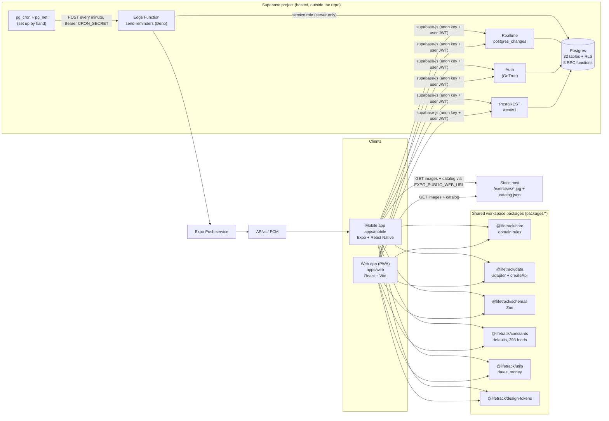
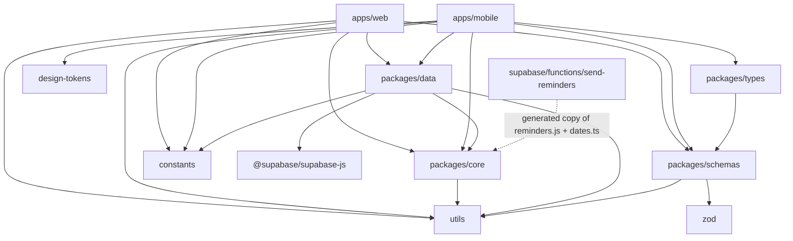
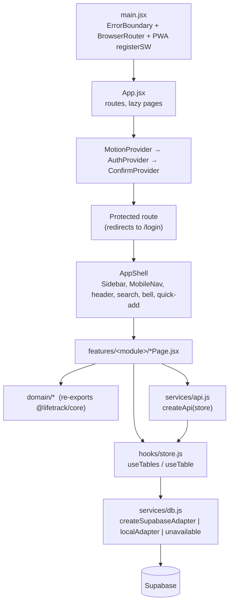
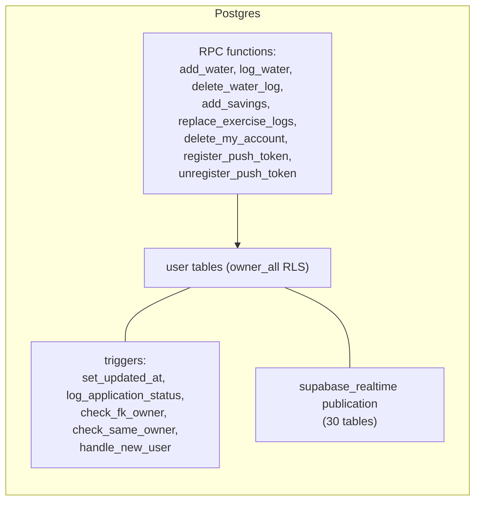
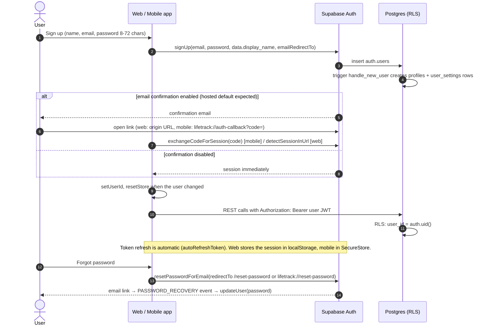

# Architecture

LifeTrack is a **serverless, client-heavy** system. There is no application server of our own: both apps talk straight to Supabase (PostgREST,
Auth, Realtime), authorisation is enforced by Postgres Row Level Security, and the only server-side code is one scheduled Edge Function that sends
reminders. All business rules are pure JavaScript shared by web and mobile.

For how a request travels see [DATA_FLOW.md](DATA_FLOW.md); for tables see [DATABASE.md](DATABASE.md); for the wire surface see [API.md](API.md).

## 1. System architecture

Key properties:

| Property | Detail |
| --- | --- |
| Source of truth | Supabase Postgres. The apps keep an **in-memory cache only**; nothing is persisted locally except the auth session and a few UI preferences. |
| Authorisation | RLS policy `owner_all` (`user_id = auth.uid()`) on every user table, `force row level security`, `anon` has no grants. Same-owner triggers guard cross-table foreign keys. |
| Keys in clients | Only the public URL and anon (publishable) key. The service-role key is used solely inside the Edge Function, where Supabase injects it. |
| Consistency | Counter-style writes (`add_water`, `add_savings`, `log_water`) and "replace all sets" run inside the database. Idempotency uses unique indexes (`23505` is treated as "someone else already did it"). |
| Offline | Not supported for editing. The PWA precaches the app shell and exercise photos only; API traffic is never cached. |

## 2. Repository / package architecture

- `@lifetrack/core` has **no** React and **no** Supabase imports. It receives raw table rows and returns derived values, which is why web and mobile show
  identical numbers (enforced by golden-dataset parity tests, `packages/core/tests/parity.test.js` and `apps/mobile/tests/parity.test.ts`).
- `@lifetrack/data` owns the Supabase adapter (`supabaseAdapter.js`), the auth wrapper (`auth.js`), error normalisation (`errors.js`) and
  `createApi(store)`, a set of 31 multi-row domain operations. Each app injects its own cache/mutation `store` (web `hooks/store.js`, mobile
  `data/queryStore.ts` on TanStack Query).
- `@lifetrack/schemas` holds Zod schemas for table rows (`tables.ts`), forms (`forms.ts`) and auth (`auth.ts`). The adapter can be wrapped with
  `withSchemaValidation` (`validatingAdapter.js`).
- The Edge Function cannot import workspace packages, so `scripts/sync-function-core.mjs` copies `packages/core/src/reminders.js` and the date helpers
  into `supabase/functions/_shared/`; CI fails if the copies are stale.

## 3. Frontend architecture (web)

| Concern | Implementation | Files |
| --- | --- | --- |
| Routing | React Router 7 (`BrowserRouter`, `useTransitions={false}`), every page lazy-loaded; unknown paths redirect to `/` | `src/App.jsx`, `src/main.jsx` |
| Server state | Custom external-store cache: per-table `{rows, status, error}`, `useSyncExternalStore`, versioned writes so a stale in-flight fetch is discarded, Realtime events applied directly, refetch on focus/online/reconnect and a 90 s safety poll | `src/hooks/store.js` |
| Mutations | `store.insert/update/upsert/remove/rpc/patch` + `services/api.js` (`createApi`). UI never calls Supabase directly | `src/services/api.js`, `src/hooks/useAction.js` |
| Forms | React Hook Form + Zod through `useDialogForm` / `useEntityForm` / `useRecordForm`; validators in `lib/validation.js` | `src/hooks/*`, `src/lib/validation.js` |
| Backend selection | Decided at **build time** (`__BACKEND__`): `supabase`, `local` (dev/E2E only) or `none` (a production build without credentials shows `ConfigError`). The unused backend is tree-shaken | `apps/web/scripts/resolve-backend.js`, `src/lib/backend.js`, `src/services/db.js` |
| Styling | Tailwind with CSS-variable tokens, `[data-module]` accent system, Inter variable font | `tailwind.config.js`, `src/index.css` |
| Charts / motion | Recharts in a lazy chunk; Motion with `LazyMotion` | `components/shared/charts.jsx`, `components/motion/*` |
| PWA | `vite-plugin-pwa`, autoUpdate, shell-only precache, runtime cache for exercise photos and catalog | `vite.config.js` |
| Background jobs while open | `useReminderRunner` and `useRecurringRunner` tick every 60 s | `features/notifications/`, `features/finance/` |

`src/domain/*.js` are one-line re-exports (`export * from '@lifetrack/core/…'`) of either the shared rules (`packages/core/src/*.js`, e.g. `nutrition`) or
the web-flavoured variants in `packages/core/src/web/*.js` (e.g. `fitness`, which adds form conversions), so pages import from one local path.

## 4. Mobile architecture

| Concern | Implementation |
| --- | --- |
| Navigation | Expo Router. `app/(auth)` (sign-in, sign-up, forgot) and `app/(app)` (5 tabs: Dashboard, Planner, Habits, Finance, More; modules under `app/(app)/module/*` pushed as stack screens). Custom `LifeTabBar` |
| Data | `src/data/queryStore.ts` implements the same store contract as the web store on TanStack Query; `RealtimeSync` re-subscribes on foreground and invalidates tables |
| Session | `expo-secure-store` through `createChunkedStorage` (sessions exceed SecureStore's per-value limit), PKCE flow, `detectSessionInUrl: false` |
| Deep links | `lifetrack://` scheme; `src/lib/deepLinks.ts` maps links and notification payloads to routes ([NATIVE.md](NATIVE.md)) |
| Push | `expo-notifications`; token registered through the `register_push_token` RPC; server sends via Expo |
| Exercise DB | Catalog and photos are fetched from the web deployment (`EXPO_PUBLIC_WEB_URL`), not bundled (`src/features/fitness/exerciseDb.ts`) |
| Builds | EAS profiles `development`, `development-simulator`, `preview`, `production` (`apps/mobile/eas.json`); local signed APKs via `scripts/release-android.sh` |

## 5. Backend architecture

- Migrations `supabase/migrations/0001…0010` are additive; `supabase/setup-all.sql` is their concatenation, generated by `pnpm sql:build`, and CI fails on drift.
- `supabase/config.toml` configures only the **local** stack used by tests (`supabase start`); hosted projects are configured in the dashboard.
- The **Edge Function** `send-reminders` is deployed with `--no-verify-jwt` and authenticates the caller itself with a constant-time comparison against
  `CRON_SECRET` (fails closed when unset). Scheduling (`pg_cron`/`pg_net`) is a manual SQL step documented in [NATIVE.md](NATIVE.md).

## 6. Authentication flow

Implemented in `packages/data/src/auth.js` (shared), `apps/web/src/hooks/useAuth.jsx`, `apps/web/src/features/auth/`,
`apps/mobile/src/providers/AuthProvider.tsx`, `apps/mobile/app/auth-callback.tsx`, `apps/mobile/app/reset-password.tsx`. Details and caveats in [SECURITY.md](SECURITY.md).

## 7. Application communication summary

| From → to | Channel | Purpose |
| --- | --- | --- |
| App → Supabase REST | HTTPS `/rest/v1/<table>`, `/rest/v1/rpc/<fn>` | All reads and writes |
| App → Supabase Auth | HTTPS `/auth/v1/*` via supabase-js | Sign-up/in/out, reset, update user, delete account (RPC) |
| Supabase → App | WebSocket, one channel `lifetrack-changes`, a binding per table | Cross-device invalidation (INSERT/UPDATE filtered by `user_id`; DELETE unfiltered, carries ids only) |
| pg_cron → Edge Function | HTTPS POST each minute | Turn due reminders into notifications and pushes |
| Edge Function → Expo → APNs/FCM → device | HTTPS | Push delivery (best effort; inbox rows are saved first) |
| App → static host | HTTPS GET | Exercise catalog JSON and photos |

## 8. Design decisions worth knowing

| Decision | Why | Consequence |
| --- | --- | --- |
| No custom API server | Smaller surface, RLS as the single authorisation layer | Business rules live in clients; every client must be trusted to compute correctly, while the database still protects ownership |
| Shared pure-JS core | Identical numbers on web and mobile | Any rule change touches both apps; parity tests guard it |
| Built-in food and exercise lists ship with the apps | Growing them can never rewrite user data; works offline | Catalog updates need an app release; custom edits are stored as per-user copies keyed by `base_key` |
| Log entries snapshot nutrition | History never changes when a food is edited | Editing a food does not retro-update past entries |
| Load whole tables, compute on device | Simple, instant UI | Cost grows with data (see [PERFORMANCE.md](PERFORMANCE.md)) |
| Dates as strings in the user's timezone | No UTC boundary bugs | The timezone setting must be consistent across devices (it is stored on the account) |
