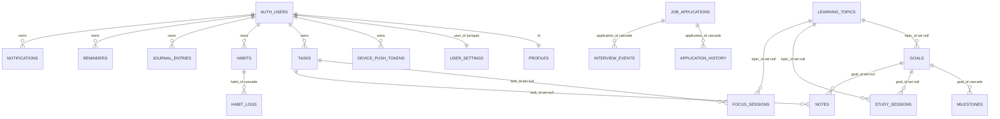
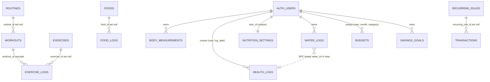

# Database

The database is **Supabase Postgres**. The source of truth is `supabase/migrations/0001…0010` (additive, re-runnable); `supabase/setup-all.sql` is their
concatenation (`pnpm sql:build`, drift-checked in CI). Zod mirrors of every table live in `packages/schemas/src/tables.ts` and a drift test fails when they
diverge. Client-side defaults and unique-constraint mirrors (used by the in-browser DEV backend) are in `packages/constants/src/schema.js`.

**32 tables** · **8 RPC functions** · **5 trigger functions** · **30 tables in the Realtime publication** · 0 views · 0 enums (text + `CHECK`).

## 1. Conventions

| Convention | Detail |
| --- | --- |
| Ownership | Every row has `user_id uuid not null default auth.uid() references auth.users(id) on delete cascade`. Exceptions: `profiles` (`id` is the user id). |
| Primary keys | `id uuid default gen_random_uuid()`. |
| Timestamps | `created_at`, `updated_at timestamptz default now()`; `updated_at` is maintained by trigger `set_updated_at` on every table except `application_history` and `exercise_logs`. |
| Dates | Plain `date` (`*_date`) computed on the client in the user's timezone (`user_settings.timezone`, default `Asia/Kolkata`). Never converted through UTC. |
| Money | Integer minor units named `*_paise` (`bigint`). The currency code only affects display (`INR`, `USD`, `EUR`). |
| Enums | `text` + `CHECK (… in (…))` so values can evolve without type migrations. |
| Security | `enable` **and** `force row level security`; `revoke all … from anon`; policy `owner_all` for role `authenticated`. |
| Realtime | All tables except `profiles` and `device_push_tokens` are in `supabase_realtime`. |

## 2. Entity-relationship diagrams

### 2.1 Account, productivity and growth

### 2.2 Fitness, health, nutrition and finance

`FOOD_LOGS.base_key` and `FOODS.base_key` refer to **built-in foods that are not in the database** (they ship with the apps), so that link has no foreign key.

## 3. Tables

Legend: **PK** primary key · **FK** foreign key · **U** unique · defaults in parentheses.

### 3.1 Account

| Table | Migration | Purpose |
| --- | --- | --- |
| `profiles` | 0001 | `id` (PK, FK `auth.users`), `display_name` (default `''`, ≤ 80). Created by trigger `handle_new_user` from `raw_user_meta_data.display_name` or the email prefix. Policy keyed on `id`. |
| `user_settings` | 0001, 0003 | One row per user (`user_id` U). |
| `device_push_tokens` | 0006 | Expo push tokens per device. |

`user_settings` columns: `timezone` ('Asia/Kolkata'), `currency` ('INR'), `theme` ('dark'; `dark|light|system`), `daily_study_target_minutes` (120; 0–1440),
`monthly_budget_paise` (0), `water_goal_ml` (3000; 0–20000), `steps_goal` (8000; 0–200000), `week_starts_on` (1; `0|1`), `habit_prefs` jsonb (`{}`; also holds the
sleep goal), `workout_plan` jsonb (`{}`; `{"0".."6": routine uuid | "rest" | null}`), `defaults_seeded` (false), `score_weights` jsonb
(`{"learning":25,"career":25,"fitness":20,"habits":15,"health":15}`), `dashboard_widgets` jsonb (`{}`; `{key:false}` hides a widget, `order` lists keys, `sizes` maps a key to `sm|md|lg|full`),
`notification_prefs` jsonb (all kinds `true`), `focus_prefs` jsonb (`{"short_break":5,"long_break":15,"long_every":4}`).

`device_push_tokens`: `token` (U; must match `^(Expo|Exponent)PushToken\[[^\]]+\]$`), `platform` (`ios|android`), `device_name` (≤ 80), `last_seen_at`.
**Clients cannot insert or update directly** (`revoke insert, update`); only SELECT and DELETE policies exist. Writes go through the RPCs below.

### 3.2 Planner, habits, focus

| Table | Key columns and constraints | Indexes |
| --- | --- | --- |
| `tasks` | `title` 1–200; `notes`; `category` (`Learning|Job Search|Gym|Health|Personal|Finance`, default Personal); `priority` (`low|medium|high`, medium); `status` (`pending|in_progress|done|skipped|cancelled`, pending); `due_date`; `started_at`; `completed_at`; `recurrence` (`none|daily|weekdays|weekly|monthly`); `recurrence_until`; `series_id` | `(user_id, due_date)`, `(user_id, status)`, **U** `(user_id, series_id, due_date)` where `series_id is not null` |
| `habits` | `name` 1–80; `description`; `color` ('#8B5CF6'); `frequency` (`daily|weekly|custom`); `days_of_week smallint[]` (0=Sun); `weekly_target` 1–7 (3); `start_date` (today in Asia/Kolkata); `archived_at` | `(user_id)` |
| `habit_logs` | `habit_id` FK cascade; `log_date`; `status` (`done|skipped|rest`, done); `note`. **U** `(habit_id, log_date)` | `(user_id, log_date)`, `(user_id, updated_at)` |
| `focus_sessions` | `session_date`; `kind` (`focus|short_break|long_break`); `planned_minutes` 1–240; `actual_seconds` ≥ 0; `completed`; `task_id` FK set null; `topic_id` FK set null; `label` ≤ 120; `started_at` | `(user_id, session_date)`, partial `task_id`, `topic_id` |

### 3.3 Learning, goals, notes

| Table | Key columns and constraints | Indexes |
| --- | --- | --- |
| `learning_topics` | `group_name` 1–60; `name` 1–80; `notes`; `revision_dates date[]`; `archived`. **U** `(user_id, group_name, name)` | (unique index) |
| `goals` | `title` 1–120; `category` (free text, default 'Learning'); `topic_id` FK set null; `target_minutes` ≥ 0; `due_date`; `status` (`active|completed|archived`); `notes`; `period` (`daily|weekly|monthly|yearly`, monthly); `start_date`; `manual_progress` 0–100; `completed_at`. `CHECK` due ≥ start | `(user_id, status)`, partial `topic_id` |
| `milestones` | `goal_id` FK cascade; `title` 1–160; `due_date`; `done`; `completed_at`; `position` | `(goal_id, position)`, `(user_id)` |
| `study_sessions` | `goal_id`, `topic_id` FK set null; `session_date`; `started_at`; `ended_at`; `duration_seconds` ≥ 0; `status` (`running|completed|discarded`); `source` (`timer|manual`); `problems_solved` ≥ 0; `notes`. `CHECK` running ⇒ no end/duration; completed ⇒ has duration. **U** one `running` per user | `(user_id, session_date)`, partial `goal_id`, `topic_id`, **U** `(user_id)` where `status='running'` |
| `notes` | `title` ≤ 160; `body` (Markdown); `category` 1–40 ('General'); `tags text[]`; `pinned`; `goal_id`, `task_id` FK set null. `CHECK` title or body non-empty | `(user_id, updated_at desc)`, GIN `tags`, partial `goal_id`, `task_id` |
| `journal_entries` | `entry_date`; `mood` 1–5; `content`; `wins`. **U** `(user_id, entry_date)` | (unique index) |

### 3.4 Job search

| Table | Key columns and constraints | Indexes |
| --- | --- | --- |
| `job_applications` | `company`, `job_title` 1–120; `jd_url`; `location`; `salary_paise` ≥ 0 (annual package); `applied_date`; `source`; `status` (`interested|preparing|applied|assessment|interview|selected|offer|rejected|withdrawn`); `contact_person`; `followup_date`; `resume_version`; `prep_checklist jsonb` (`[{id,text,done}]`); `notes` | `(user_id, status)`, `(user_id, followup_date)` |
| `application_history` | `application_id` FK cascade; `from_status`; `to_status`; `note`; `changed_at`. **Written by trigger** `log_application_status` on insert and on status change; has no `updated_at` | `(application_id, changed_at)`, `(user_id, changed_at)` |
| `interview_events` | `application_id` FK cascade; `round_name`; `scheduled_at timestamptz`; `mode` (`video|phone|onsite|other`); `link`; `status` (`scheduled|completed|cancelled`); `notes` | `(user_id, scheduled_at)`, `(application_id)` |

### 3.5 Fitness and health

| Table | Key columns and constraints | Indexes |
| --- | --- | --- |
| `exercises` | `name` 1–80; `muscle_group`; `equipment`. **U** `(user_id, name)`. The user's own library (seeded with 26 defaults) | unique index |
| `routines` | `name` 1–80; `exercises jsonb` (`[{name, sets, reps, weight_kg}]`); `notes`; `archived_at` | `(user_id)` |
| `workouts` | `routine_id` FK set null; `workout_date`; `name` ('Workout'); `kind` (`strength|cardio|mixed|other`); `status` (`completed|skipped|rest`); `duration_minutes` 0–1440; `cardio_minutes`; `cardio_distance_km numeric(6,2)`; `notes` | `(user_id, workout_date)`, partial `routine_id` |
| `exercise_logs` | `workout_id` FK cascade; `exercise_id` FK set null; `exercise_name`; `order_index`; `set_number` ≥ 1; `reps` ≥ 0; `weight_kg numeric(6,2)` ≥ 0. No `updated_at` | `(workout_id)`, `(user_id, exercise_name)`, partial `exercise_id` |
| `body_measurements` | `measured_on`; `chest_cm`, `waist_cm`, `hips_cm`, `arm_cm`, `thigh_cm numeric(5,1)`; `body_fat_pct numeric(4,1)`; `notes`. **U** `(user_id, measured_on)` | unique index |
| `health_logs` | `log_date` (the **wake-up** date); `bedtime`, `wake_time time`; `sleep_minutes` 0–1440; `water_ml` 0–20000; `steps` 0–200000; `energy_level` 1–5; `weight_kg` 20–500; `notes`. **U** `(user_id, log_date)` | `(user_id, updated_at)` |

### 3.6 Food and nutrition (migrations 0009, 0010)

| Table | Key columns and constraints | Indexes |
| --- | --- | --- |
| `foods` | `name` 1–80; `category` 1–40 ('Other'); `base_key` (the built-in food this row replaces); `serving_label` 1–60; `serving_g numeric(7,1)` > 0; `kcal` 0–5000, `protein_g` 0–500, `carbs_g` 0–1000, `fat_g` 0–500, `fiber_g` 0–200 (all per **one** serving); `servings jsonb` (array ≤ 12 of `{label, factor}`); `variants jsonb` (array ≤ 12); `notes` ≤ 300; `aliases text[]` (≤ 12 items, ≤ 800 chars); `source` ≤ 80 | **U** `(user_id, base_key)` where not null, `(user_id, lower(name))`, `(user_id, category)`, GIN `aliases` |
| `food_logs` | `log_date`; `log_time`; `meal_type` (`breakfast|lunch|snack|dinner`); `name` 1–120; `category`; `food_id` FK set null; `base_key`; `variant` ≤ 60; `quantity numeric(7,2)` 0–1000; `serving_label`; **totals** `kcal` 0–20000, `protein_g` 0–2000, `carbs_g` 0–4000, `fat_g` 0–2000, `fiber_g` 0–1000; `notes` ≤ 300 | `(user_id, log_date desc, log_time)`, `(user_id, updated_at)`, partial `food_id`, partial `(user_id, base_key)` |
| `water_logs` | `log_date`; `log_time`; `amount_ml` 1–5000 | `(user_id, log_date desc, created_at)` |
| `nutrition_settings` | One row per user (**U** `user_id`). `calorie_goal` 500–10000; `protein_goal_g` 1–1000; `carbs_goal_g` 1–2000; `fat_goal_g` 1–1000; `fiber_goal_g` 1–500 (all nullable = "no target"); `favorite_foods jsonb` (array ≤ 200 of `"starter:<key>"` / `"custom:<uuid>"`) | unique |

### 3.7 Finance

| Table | Key columns and constraints | Indexes |
| --- | --- | --- |
| `transactions` | `type` (`income|expense|savings`); `amount_paise` > 0; `category` ('Other'); `txn_date`; `note`; `payment_method` (`Cash|UPI|Credit card|Debit card|Bank transfer|Other`); `recurring_rule_id` FK set null; `recurring_date`. `CHECK` rule ⇒ date | `(user_id, txn_date)`, `(user_id, updated_at)`, **U** `(user_id, recurring_rule_id, recurring_date)` where rule not null, partial `recurring_rule_id` |
| `budgets` | `month` (first day of month, `CHECK`); `category` ('' = overall); `amount_paise` ≥ 0. **U** `(user_id, month, category)` | unique index |
| `savings_goals` | `name` 1–80; `target_paise` > 0; `saved_paise` ≥ 0; `target_date` | `(user_id)` |
| `recurring_rules` | `type`; `amount_paise` > 0; `category` 1–40; `payment_method`; `note` ≤ 300; `frequency` (`daily|weekly|monthly|yearly`); `anchor_day` 1–31; `next_date`; `end_date`; `active` | `(user_id, next_date)` |

### 3.8 Reminders and notifications

| Table | Key columns and constraints | Indexes |
| --- | --- | --- |
| `reminders` | `kind` (`task|study|workout|habit|bill|custom`); `title` 1–160; `remind_date`; `remind_time` ('09:00'); `repeat` (`none|daily|weekly|monthly`); `active`; `last_fired_on` | `(user_id, remind_date)` |
| `notifications` | `kind` (adds `system`); `title` 1–200; `body`; `link`; `dedupe_key`; `read_at`. **U** `(user_id, dedupe_key)` where not null | `(user_id, created_at desc)` |

## 4. Functions and triggers

| Name | Type | Security | Purpose |
| --- | --- | --- | --- |
| `set_updated_at()` | trigger fn | invoker | Sets `updated_at = now()` before update |
| `handle_new_user()` | trigger fn on `auth.users` insert | **definer**, `search_path=''` | Creates `profiles` and `user_settings` rows |
| `log_application_status()` | trigger fn | invoker | Writes `application_history` on insert / status change |
| `check_fk_owner(col, parent, …)` | trigger fn | invoker | Rejects a child pointing at another user's parent (`23503`). Installed on `habit_logs`, `study_sessions`, `goals`, `focus_sessions`, `exercise_logs`, `interview_events`, `workouts`, `application_history`, `transactions`, `food_logs` |
| `check_same_owner()` | trigger fn | invoker | Same guard for `milestones` and `notes` (older mechanism from 0003) |
| `delete_my_account()` | RPC | **definer** | Deletes the caller from `auth.users`; everything cascades |
| `add_water(p_date, p_ml)` | RPC → `health_logs` | invoker | Atomic upsert of `water_ml`, clamped 0–20000 |
| `log_water(p_date, p_ml, p_time)` | RPC → `jsonb {entry, health}` | invoker | Inserts a `water_logs` row and calls `add_water`; `p_ml` 1–5000 |
| `delete_water_log(p_id)` | RPC → `health_logs` | invoker | Deletes the entry and subtracts its amount |
| `add_savings(p_goal, p_paise)` | RPC → `savings_goals` | invoker | Atomic `saved_paise + p_paise` |
| `replace_exercise_logs(p_workout, p_sets jsonb)` | RPC → rows | invoker | Replaces all sets of a workout in one transaction |
| `register_push_token(token, platform, device_name)` | RPC | **definer** | Upserts a token, reassigning it to the caller |
| `unregister_push_token(token)` | RPC | **definer** | Deletes the caller's token |

All RPCs: `revoke all … from public, anon; grant execute … to authenticated`. Four functions are `SECURITY DEFINER` (`handle_new_user`, `delete_my_account`,
`register_push_token`, `unregister_push_token`), all with `set search_path = ''`.

## 5. Data ownership and retention

- Every row belongs to exactly one user and is removed when that user is deleted (`on delete cascade` from `auth.users`).
- Deleting a parent never deletes history that should survive it: `set null` for goals/topics/tasks/routines/exercises/foods/recurring rules; `cascade` only for true
  children (habit logs, milestones, application history, interviews, sets).
- There is no soft delete, no audit log and no multi-user sharing. `habits.archived_at`, `routines.archived_at`, `goals.status='archived'`,
  `learning_topics.archived` are user-visible archives, not deletions.
- Not included in JSON backups or erased by "Erase all data": `profiles`, `device_push_tokens` ( `ALL_TABLES` in `packages/constants/src/schema.js` lists 30 tables).

## 6. Built-in data that is **not** in the database

| Data | Where | Notes |
| --- | --- | --- |
| 293 built-in foods | `packages/constants/src/foods.js` + `foods/*.js` | Referenced by `base_key` / `"starter:<key>"`; keys are permanent |
| 876 exercises + photos | `apps/web/public/exercises/` | Matched by name; not referenced by id |
| 26 default exercises, default learning topics | `packages/constants/src/defaults.js` | Copied into the user's tables once by `seedDefaults()` (`defaults_seeded`) |

## 7. Migrations

| File | Adds | Must run before |
| --- | --- | --- |
| `0001_schema.sql` | Core tables (20), `set_updated_at`, `handle_new_user`, `log_application_status` | everything |
| `0002_rls_realtime.sql` | RLS + `owner_all`, Realtime publication, `delete_my_account` | any client use |
| `0003_focus_notes_goals_reminders.sql` | `focus_sessions`, `notes`, `milestones`, `savings_goals`, `reminders`, `notifications`; settings JSON columns; `offer` status; `payment_method`; goal columns; `check_same_owner` | Focus, Notes, Goals, Finance savings, Notifications |
| `0004_hardening.sql` | `check_fk_owner` on 7 tables, FK indexes, `add_water`, `replace_exercise_logs` | Health water, saving workouts |
| `0005_history_owner_guard_and_user_indexes.sql` | Guard on `application_history`; 3 indexes | — |
| `0006_push_tokens.sql` | `device_push_tokens`, register/unregister RPCs | Mobile push |
| `0007_savings_atomic.sql` | `add_savings` | Adding to savings goals |
| `0008_recurring_rules.sql` | `recurring_rules`; `transactions.recurring_*` | Recurring transactions |
| `0009_nutrition.sql` | `foods`, `food_logs`, `water_logs`, `nutrition_settings`, `log_water`, `delete_water_log` | **Food & Nutrition, dashboard Food widget, backup of nutrition tables** |
| `0010_food_database.sql` | `foods.aliases`, `foods.source`, 3 indexes | Custom foods with other names |

Operational notes:

- Migrations are **additive and safe to re-run**; `scripts/check-migration-safety.mjs` blocks drops/truncates/renames unless a reviewed
  `-- lifetrack:allow-destructive <reason>` marker is present.
- Apply on an existing project in order, once each (or use the *Database migrations (manual)* workflow — see [DEPLOY.md](DEPLOY.md)). A project created by pasting
  `setup-all.sql` has no migration history, so mark applied versions first with `supabase migration repair --status applied …`.
- The root `CHANGELOG.md` says to run `0009_nutrition.sql` and `0010_food_database.sql` **before releasing** a build that includes Food & Nutrition; the app does
  not check which migrations a project has (a missing table surfaces as the "database is missing the latest LifeTrack tables" error from `errors.js`, which still
  names `0003` — see [KNOWN_ISSUES.md](KNOWN_ISSUES.md)).
- `docs/SETUP.md` and `docs/QUICKSTART.md` still list fewer migrations than exist; trust this table ([KNOWN_ISSUES.md](KNOWN_ISSUES.md)).

## 8. Validation layers

1. **Zod forms** (`packages/schemas/src/forms.ts`, `apps/web/src/lib/validation.js`) — user-facing messages.
2. **Optional schema validation** of adapter I/O (`withSchemaValidation`, `tables.ts`).
3. **Postgres `CHECK`/unique/trigger constraints** — the last line of defence; violations come back as `23514`, `23505`, `23503`, `23502` and are mapped to friendly text
   in `packages/data/src/errors.js`.
