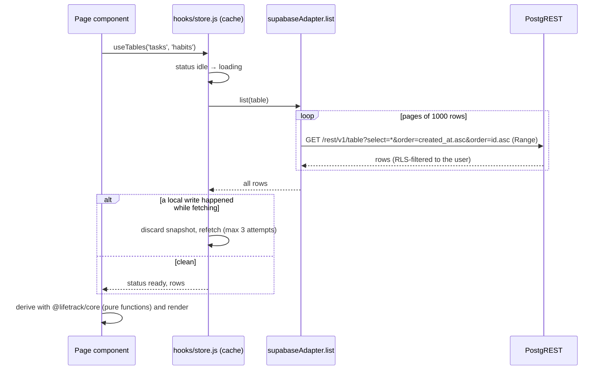
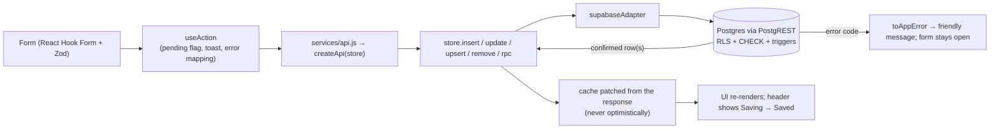
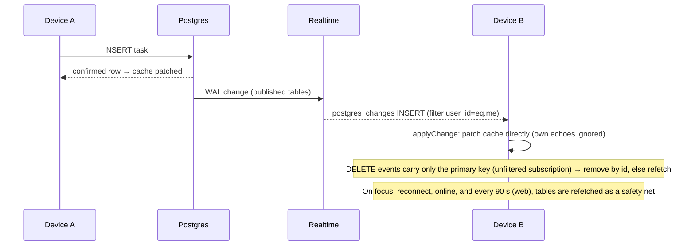
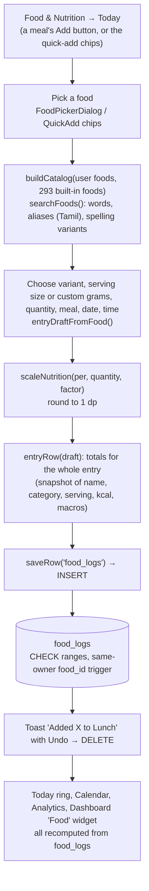
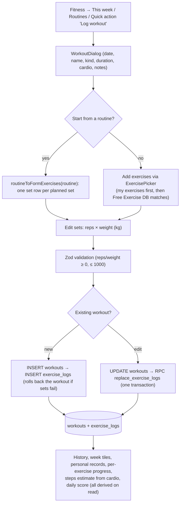
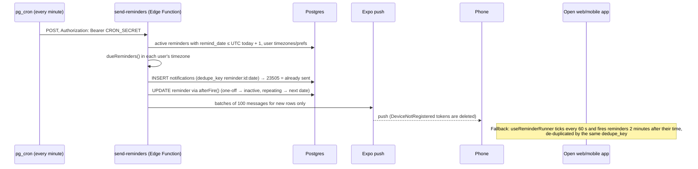

# Data flow

How data moves through LifeTrack. System context is in [ARCHITECTURE.md](ARCHITECTURE.md); error handling is in [ERROR_HANDLING.md](ERROR_HANDLING.md).

## 1. Read path (every module)

- **Whole-table loads.** Each module loads the complete table(s) it needs, then filters and aggregates on the device (`packages/core`). Pagination exists only
  to get past PostgREST's 1,000-row cap. See [PERFORMANCE.md](PERFORMANCE.md).
- A failed *background* refresh keeps the data on screen; only a failed *first* load becomes an error state with a Retry button.
- Date columns are plain `yyyy-MM-dd`; "today" is computed on the device in the account's timezone (`useToday`).

## 2. Write path

Rules enforced in code:

1. `user_id` is never sent: the adapter strips it and the column default `auth.uid()` fills it; RLS rejects anything else.
2. Writes are **not optimistic**: the cache is updated from the confirmed response, so what you see is what the database holds.
3. Multi-row/counter operations are single database calls (`rpc`) so retries and concurrent devices cannot corrupt data.
4. Forms stay open on failure and a leave-page prompt appears while a save is in flight (`docs/SETUP.md` "Design notes").

## 3. Synchronisation between devices

- One channel, `lifetrack-changes`, with an INSERT/UPDATE/DELETE binding for each of the 30 published tables (`ALL_TABLES`).
- Web: events go to `applyChange`; an older `updated_at` than the cached row is ignored. Mobile: events call `store.invalidate(table)`, and the channel is
  torn down in background and rebuilt on foreground (`apps/mobile/src/providers/RealtimeSync.tsx`).
- The header "Live sync" dot reflects the channel status (`StatusIndicators.jsx`).

## 4. Food logging flow

Water: `logWater(date, ml, time)` → RPC `log_water` inserts a `water_logs` row **and** adds to `health_logs.water_ml` in one transaction, returning both
rows; `removeWaterLog` → RPC `delete_water_log` reverses it. Details in [FOOD_NUTRITION.md](FOOD_NUTRITION.md).

## 5. Workout logging flow

`workoutRows()` links each set to a library exercise by case-insensitive name (`exercise_id` stays `null` when the name came from the database catalog and
has not been added to "My exercises"). Details in [GYM_FITNESS.md](GYM_FITNESS.md).

## 6. Reminder and notification flow

## 7. Recurring transactions flow

`useRecurringRunner` (web, every 60 s) and `RecurringRunner` (mobile) call `postDueRecurring(today)`: re-read rules, compute every missed occurrence
(`dueOccurrences`, capped by `MAX_CATCH_UP`), insert each as a `transactions` row **dated the day it fell due**, then advance `next_date`. The unique index
`transactions_recurring_occurrence_uq` makes concurrent devices safe. Nothing posts while no device has the app open.

## 8. Backup / restore flow

Export reads every table straight from the database (not the cache) into `{app, version, exported_at, tables}`. Restore validates the envelope with Zod
(≤ 50 MB, ≤ 200,000 rows per table), re-stamps ownership, merges rows by `id` in parent-before-child order (`TABLES`), remaps foreign keys for tables with a
natural unique key (topics, exercises, foods) and never deletes. See [BACKUP_RECOVERY.md](BACKUP_RECOVERY.md).
