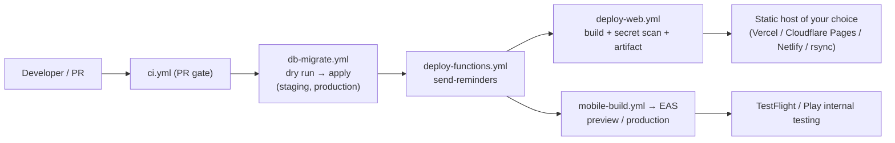

# Deployment

The step-by-step runbooks are [DEPLOY.md](DEPLOY.md) (workflows), [RELEASE.md](RELEASE.md) (release checklist and device matrix) and [NATIVE.md](NATIVE.md) (push, deep links, EAS). This document is the
overview and the verified facts behind them. **Nothing deploys automatically**: every release step is a manually started GitHub Actions workflow. None of these workflows has been run in a live environment
([README.md](../README.md) "Honest status").

## 1. Release architecture



Suggested order: **migrations → Edge Function → web → mobile**. Migrations are additive and the apps tolerate an older schema except for features that need the new tables, so a partial rollout is safe.
Roll back application code by redeploying the previous build; roll back a migration only with a new forward migration.

## 2. Environment configuration

| Where | Variables |
| --- | --- |
| GitHub Environment `staging` / `production` — variables | `SUPABASE_PROJECT_REF`, `VITE_SUPABASE_URL`, `VITE_SUPABASE_ANON_KEY` (public values) |
| GitHub Environment secrets | `SUPABASE_ACCESS_TOKEN`, `SUPABASE_DB_PASSWORD`; `EXPO_TOKEN` for EAS builds |
| Supabase function secrets | `CRON_SECRET` (required), `EXPO_ACCESS_TOKEN` (only if Expo "enhanced push security" is on) |
| EAS environment variables per profile | `EAS_PROJECT_ID`, `EXPO_PUBLIC_SUPABASE_URL`, `EXPO_PUBLIC_SUPABASE_ANON_KEY`, `EXPO_PUBLIC_WEB_URL`; file secret `GOOGLE_SERVICES_JSON` |
| Local Android release | `apps/mobile/.env.local` with the three `EXPO_PUBLIC_*` values; signing key stored **outside** the repo (`scripts/release-android.sh`) |

No workflow needs the Supabase service-role key. Put required reviewers on the `production` Environment.

## 3. Production build

| App | Command | Output | Guards |
| --- | --- | --- | --- |
| Web | `pnpm build` (runs `prebuild` = exercise-image verification, then `vite build`) | `apps/web/dist` (hashed assets, `sw.js`, `manifest.webmanifest`, `/exercises/`) | Refuses to build a usable app without credentials (`__BACKEND__ = 'none'`); `check-no-secrets` and `verify:bundles` in CI; `check-legal-ready.mjs` for production |
| Mobile (cloud) | `eas build --profile production --platform all` via *Mobile build (EAS)* | Android App Bundle / iOS archive; `autoIncrement` build numbers; `appVersionSource: remote` | `app.config.ts` throws if `EAS_PROJECT_ID`, URL, anon key or `EXPO_PUBLIC_WEB_URL` is missing, or the "public" key looks secret |
| Mobile (local APK) | `scripts/release-android.sh [--publish]` | Signed APK; `--publish` creates a GitHub Release | Needs the signing key and `.env.local` |

Versions: `apps/mobile/app.config.ts` `version` (currently `2.3.0`, tagged `v2.3.0`); `apps/web/package.json` is still `1.0.0` and `CHANGELOG.md` has no per-version
sections after `1.0.0` ([KNOWN_ISSUES.md](KNOWN_ISSUES.md)). Over-the-air updates are **not** enabled (`expo-updates` not installed); every change ships through a store build.

## 4. Hosting requirements

- **Web:** any static host that (1) serves `/index.html` for unknown paths (`vercel.json` rewrite / `public/_redirects` `/* /index.html 200`), (2) serves the security headers (`vercel.json` or `public/_headers`),
  (3) does **not** cache `sw.js` or `manifest.webmanifest` (headers provided), (4) serves `/exercises/` (≈ 99 MB, also used by the mobile app), and (5) uses HTTPS (required for PWA install and the service worker).
  The workflow `deploy-web.yml` only builds and uploads an artifact; **the publish step is a placeholder** to fill in.
- **Backend:** a Supabase project (Postgres, Auth, Realtime, Edge Functions, `pg_cron`, `pg_net`, Vault). The free tier suffices for personal use; enable Point-in-time recovery or backups on production.
- **Mobile:** Apple Developer and Google Play accounts, an Expo account, Firebase project (FCM v1) for Android push, APNs key via `eas credentials` for iOS push.

## 5. Database deployment

1. Take a backup (Dashboard → Database → Backups).
2. Run *Database migrations (manual)* with `apply` off and `first_pending` set to the first migration the target lacks (e.g. `0009`). It fails on destructive statements, shows local vs remote history and the plan.
3. Review, run again with `apply` on (production also needs `confirm = apply-production` and reviewer approval).
4. First use on a project created from `setup-all.sql`: `supabase migration repair --status applied 0001 … 0008` (list what is really applied), then dry-run again.
5. Verify: `select version from supabase_migrations.schema_migrations order by 1;` shows `0001`–`0010`. (`RELEASE.md` still says "through 0008" — see [KNOWN_ISSUES.md](KNOWN_ISSUES.md).)

A new project can simply run `supabase/setup-all.sql` once.

## 6. Backend (Edge Function) deployment

```bash
supabase secrets set CRON_SECRET=<long random string>
supabase functions deploy send-reminders --no-verify-jwt     # or the "Deploy Edge Functions (manual)" workflow
```

Then create the schedule in the SQL editor (not a migration, because it contains your URL and secret): `pg_cron` + `pg_net` + a Vault secret; full SQL in [NATIVE.md](NATIVE.md) step 6. Verify with
`select * from cron.job_run_details order by start_time desc limit 5;`. The function reads `SUPABASE_URL` and `SUPABASE_SERVICE_ROLE_KEY` from Supabase itself.

## 7. Frontend deployment

Vercel (configured): Root Directory `apps/web`, install `pnpm install --frozen-lockfile`, build `pnpm build`, output `dist`, set the two `VITE_` variables **before** building. Cloudflare Pages: same build,
`public/_redirects` and `public/_headers` apply. Other hosts: replicate rewrites and headers from `vercel.json`. After publishing: open `/privacy`, `/terms`, a deep link such as `/finance`, and confirm `sw.js` is fresh.

## 8. Domain and HTTPS

The repository does not configure a domain. Choose the public web URL first because it is used in four places: Supabase Auth Site URL and redirect URLs, `EXPO_PUBLIC_WEB_URL` (mobile privacy/terms links and
exercise database), the store listings, and the CSP `connect-src` (which only allows `https://*.supabase.co` and `wss://*.supabase.co`; **extend it if you add another origin or use a custom Supabase domain**).
HTTPS and HSTS (`max-age=63072000; includeSubDomains`) come from the host. `lifetrack://` is the only mobile scheme; universal links are not configured.

## 9. Backup and recovery in production

Supabase backups/PITR for the database; user-level JSON export on web ([BACKUP_RECOVERY.md](BACKUP_RECOVERY.md)). The built-in foods and exercises are in git and rebuilt with each app build, so they need no backup.

## 10. Deployment checklist

- [ ] CI green (`ci.yml`) and, once, `ci-backend.yml`
- [ ] Hosted Auth hardened: confirmation on, leaked-password protection, minimum length ≥ 8, redirect URLs exact, sign-ups disabled if single-user
- [ ] Backup taken; migrations `0001`–`0010` applied (dry run first)
- [ ] `CRON_SECRET` set; function deployed; cron job created and returning 200
- [ ] Legal documents finished (`check-legal-ready.mjs`), `LICENSE`/`SECURITY.md` placeholders filled
- [ ] Web built against the right project, secrets scan passed, artifact published, SPA fallback and headers verified
- [ ] `EXPO_PUBLIC_WEB_URL` points at the live web app and serves `/exercises/`
- [ ] EAS build `preview` tested on 2 iOS + 2 Android devices ([RELEASE.md](RELEASE.md) §7), then `production` → internal testing
- [ ] Smoke test on live: sign up, add data, sign out/in, second device sync, delete a test account
- [ ] Monitoring plan for the first week ([RELEASE.md](RELEASE.md) §9); previous build kept for rollback
